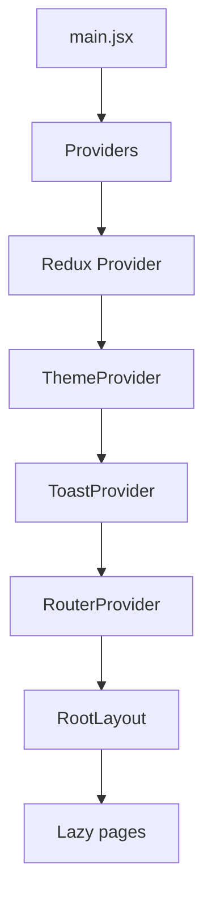
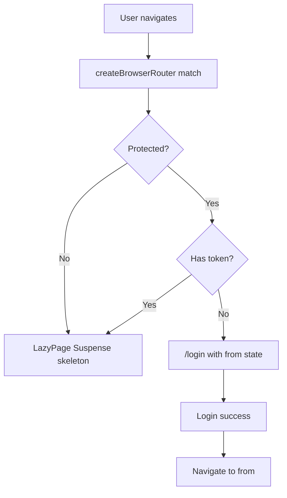
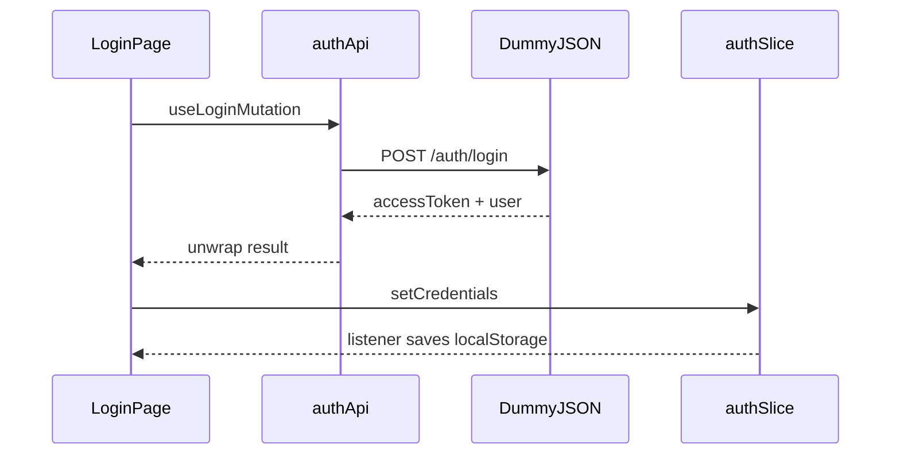
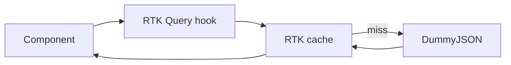
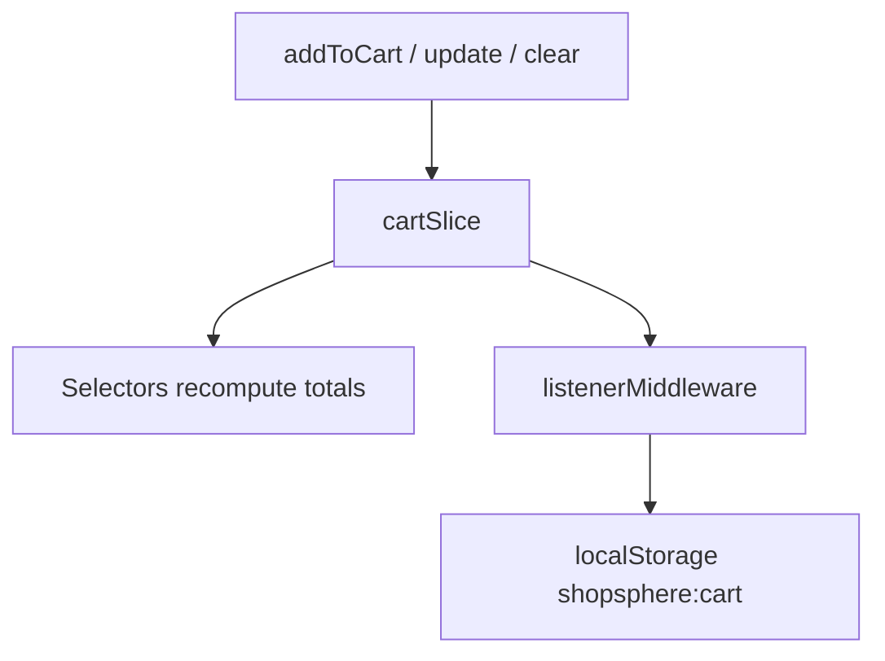
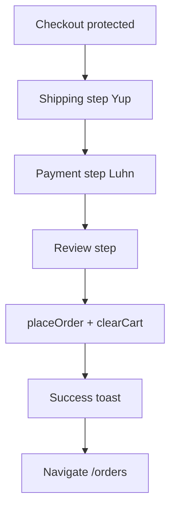
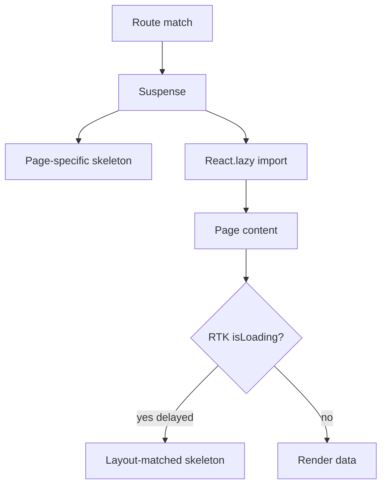

# ShopSphere Knowledge Transfer

## (a) Project purpose

ShopSphere is a frontend-only e-commerce demo built with React + Vite. It showcases routing, Redux Toolkit, RTK Query, Context API, Formik/Yup, lazy loading, skeleton UX, and responsive flat Indigo Minimal design against the public DummyJSON API.

Demo login: `emilys` / `emilyspass`.

## (b) Architecture overview

```
main.jsx → Providers (Redux, Theme, Toast) → RouterProvider
  RootLayout (Navbar + Footer)
    Lazy route pages (Suspense + ErrorBoundary + page skeletons)
      Feature components → RTK Query / Redux slices / Formik
```

Data from DummyJSON flows only through RTK Query. Cart, wishlist, auth, and orders live in Redux and are persisted with `createListenerMiddleware`.

## (c) Mermaid flow diagrams

### App boot and provider tree



### Routing and protected-route flow



### Auth flow



### RTK Query data flow



### Cart and persistence flow



### Checkout flow



### Lazy-load and skeleton flow



## (d) Features and folders

### `src/app`
Store configuration, `baseApi`, listener middleware, and `Providers`.

### `src/features/products`
Catalog home, product list (URL filters), detail with prefetch, gallery, reviews.

### `src/features/cart`
Cart page, lazy cart drawer, quantity updates, derived totals.

### `src/features/wishlist`
Toggle wishlist items; empty state; grid reuse.

### `src/features/auth`
Login Formik form, credentials slice, DummyJSON login/me endpoints.

### `src/features/profile`
Profile edit form and lazy theme panel.

### `src/features/checkout`
Multi-step Formik checkout with Luhn validation.

### `src/features/orders`
Local order history after checkout.

### `src/components/ui` and `skeletons`
Shared flat UI kit and layout-matched loading placeholders.

### `src/context`
Theme and Toast contexts only.

### `src/routes`
Router, ProtectedRoute, ErrorBoundary, LazyPage wrapper.

## (e) State management map

| Concern | Home | Why |
| --- | --- | --- |
| Auth token/user | Redux + localStorage | Shared, persisted, used in prepareHeaders |
| Cart / wishlist / orders | Redux + localStorage | Cross-route, derived selectors |
| Product catalog cache | RTK Query | Server state with tags/prefetch |
| Theme | Context + localStorage | UI-only, avoid Redux noise |
| Toasts | Context | Ephemeral UI feedback |
| Filters/sort/page/q | URL search params | Shareable source of truth |
| Form drafts | Formik local state | Step validation, not global |

## (f) Design system

- **Palette:** Indigo accent (`#4F46E5` / `#818CF8`), slate neutrals, success/warning/danger.
- **Surfaces:** Light `#FFFFFF` on `#F8FAFC`; dark `#111827` on `#0B1020`.
- **Shape:** 12px cards, 8px controls, 1px borders, single `--shadow-sm`.
- **Type:** Poppins with fluid `clamp()` scale.
- **Motion:** 150–200ms opacity/color only; shimmer disabled under reduced motion.
- **Breakpoints:** 480 / 768 / 1024 / 1280 / 1536.

### Skeleton map

| View | Skeleton |
| --- | --- |
| Route fallbacks | Page / ProductGrid / ProductDetail / Form / Profile / OrderRow / CartItem |
| Product cards/grid | ProductCardSkeleton / ProductGridSkeleton |
| Detail gallery/reviews | Suspense + Skeleton blocks |
| Cart drawer | CartItemSkeleton while lazy loading |
| Checkout steps | FormSkeleton |

### Responsive behavior

- Navbar: mobile search sheet + drawer; desktop inline search/nav.
- Grid: 1→2→3→4→5 columns by width.
- Filters: sidebar ≥1024px; bottom sheet below.
- Detail: stacked + sticky CTA on mobile; two columns ≥768px.
- Cart: stacked cards; sticky summary desktop; fixed bar mobile.
- Checkout stepper: compact mobile status; full labels ≥768px.

## (g) Performance techniques

- Route and below-the-fold `React.lazy` + Suspense skeletons.
- `React.memo` ProductCard; `useCallback`/`useMemo` where children are memoized.
- `useDebounce(400)` for search; `useDelayedFlag(150)` against skeleton flash.
- RTK `selectFromResult`, `usePrefetch`, `keepUnusedDataFor`.
- Vite `manualChunks` for `react`, `redux`, `formik`.
- `npm run analyze` → `dist/stats.html`.
- Lazy images with `loading="lazy"`, reserved aspect-ratio, thumbnail srcset.

### Bundle notes (production build)

| Chunk | Approx gzip |
| --- | --- |
| react | ~96 KB |
| redux | ~28 KB |
| formik | ~27 KB |
| index (app shell) | ~9 KB |

## (h) How to extend

1. Add a feature folder under `src/features/<name>`.
2. Inject RTK endpoints into `baseApi` if server data is needed.
3. Prefer URL params for shareable list state.
4. Add a layout-matched skeleton before wiring async UI.
5. Keep files under ~150 lines; one component per file.
6. Run `npm run lint` and `npm run build` after changes.

## (i) Glossary

- **DummyJSON:** Public mock REST API used as the only backend.
- **RTK Query:** Data-fetching layer on Redux Toolkit.
- **Listener middleware:** Redux middleware used here for localStorage persistence.
- **Protected route:** Wrapper that redirects unauthenticated users to `/login`.
- **Indigo Minimal:** Flat 2D design theme for ShopSphere.
- **Layout-matched skeleton:** Placeholder with the same dimensions as final content.
